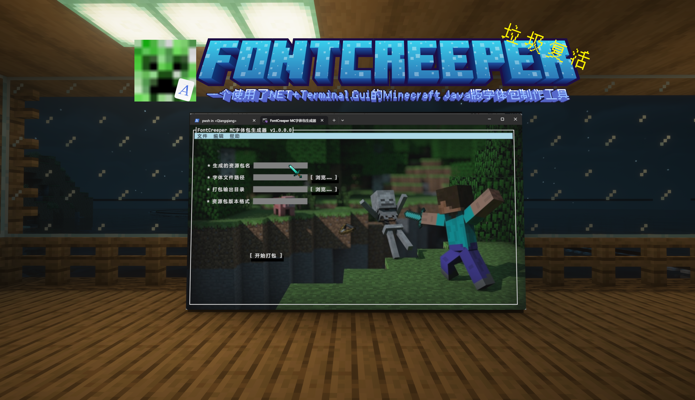
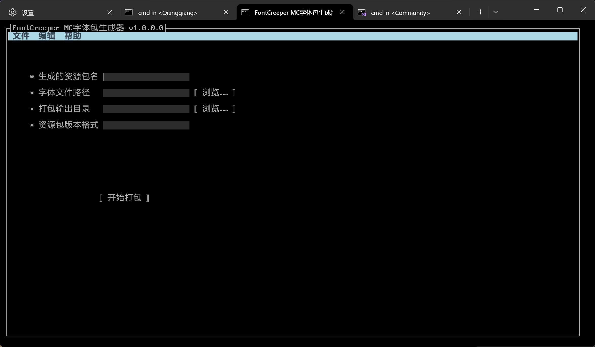
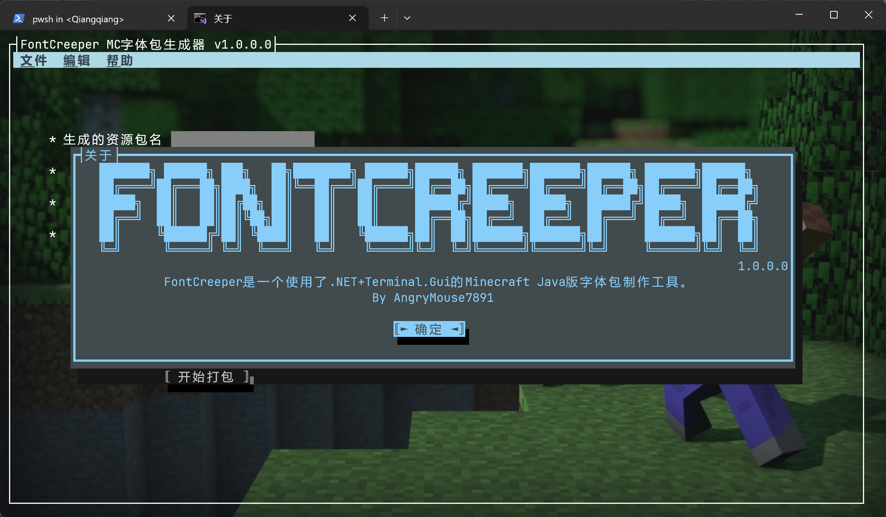
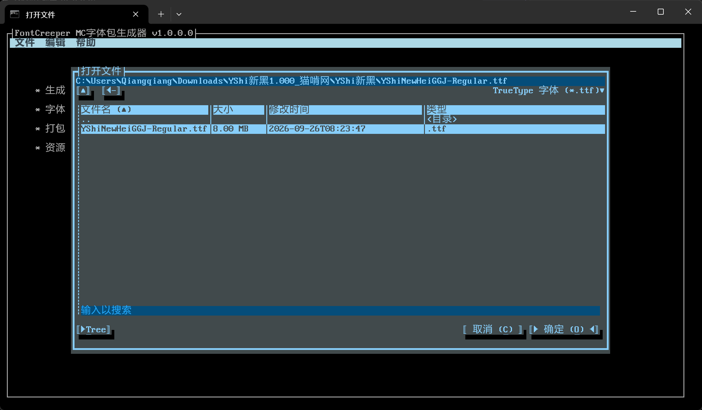
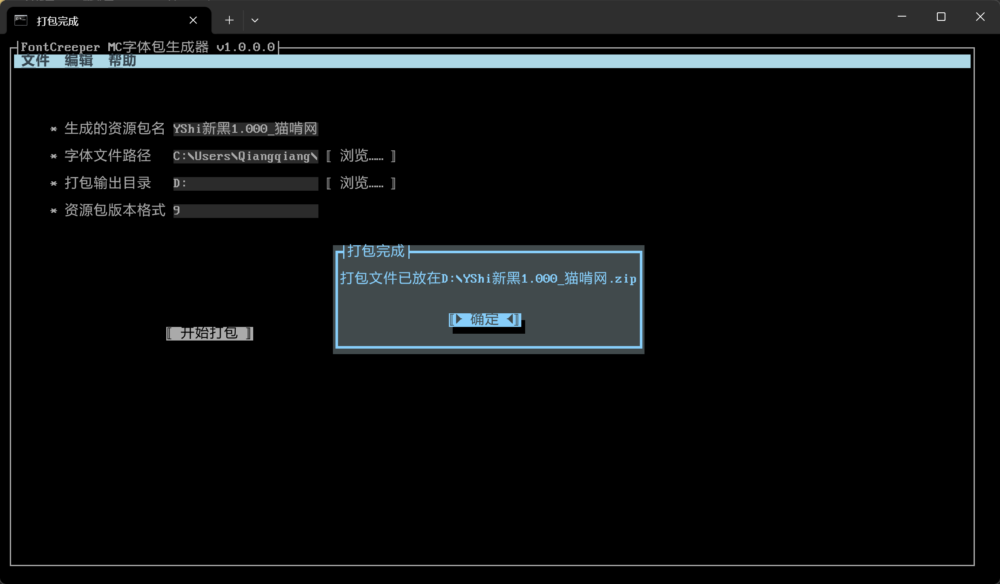

 
    

 

# 
 FontCreeper 

	 
	
   
   
   

## 简介

FontCreeper是一个使用了.NET+Terminal.Gui的Minecraft Java版字体包制作工具。

> [!WARNING]
> 该软件仅支持Minecraft Java版1.13及以上的字体包制作，如果你想生成适用于Minecraft Java版1.12.2及以下或Minecraft基岩版的字体包，请使用[FontCraft Classic](https://codepen.io/devbobcorn/full/oNEgvNv)。 
> 字体包可能打包成功但无法加载，且制作的字体包禁止用于售卖！

## 特性

* ✅ 完全使用C#编写
* ✅ 使用Terminal.Gui框架开发
* ✅ 支持Minecraft Java版1.13及以上版本
* ✅ 完全跨平台，支持Windows和Linux

## 截图

### 菜单

### 关于

### 文件选择

### 打包完成

## 使用库

| 包名 | 版本 | 描述 |
| :---------: | :-------: | :----------: |
| [`Terminal.Gui`](https://www.nuget.org/packages/Terminal.Gui/) | `2.4.17` | 终端界面框架 |
| [`WixToolset.UI.wixext`](https://www.nuget.org/packages/WixToolset.UI.wixext/) | `7.0.0` | 安装包界面 |

## 开源协议

该项目使用[GNU 宽通用公共许可证 v3.0](https://www.gnu.org/licenses/lgpl-3.0.zh-cn.html)开源。​
